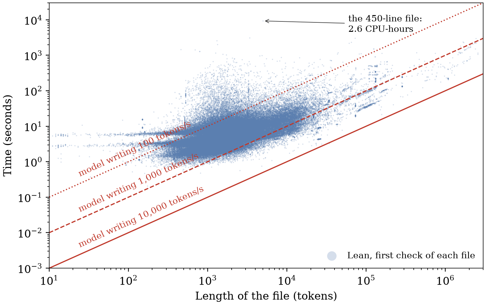

# AI Now Writes Lean Proofs Faster Than Lean Can Check Them

AI is getting better at writing mathematical proofs, which raises a question: can we keep up with checking what it writes? The usual answer is formal verification. The AI writes its proof as Lean code, Lean checks every step automatically, a proof that passes is correct, and machine checking is fast and cheap.

We tested that answer on OpenAI's public library of AI-generated mathematics and found that AI now writes Lean proofs faster than Lean can check them. A model can write a 450-line file in under a minute; Lean, on one processor core, took 2.6 hours to check it. Across the library's 162,170 files, a model writing 1,000 tokens per second finishes first on 95% of them (a token is the unit of text a model emits, two or three characters of Lean source on average). Formal verification is supposed to be the cheap step that lets us trust AI-written mathematics. For AI-written proofs, it is becoming the expensive one.

If models keep getting faster, the gap will widen. Model output speeds keep rising with better hardware and batched inference, Lean checks each file on essentially one processor core, and AI-written proofs hand more and more of their search and computation to Lean.

<!-- more -->

## File by file

Figure 1 puts the two speeds side by side. The three red lines show how long a model takes to write a file at 100, 1,000 and 10,000 tokens per second. The first rate is roughly one chat-style stream; one GPU serving a small model in batches already passes the last one, and in an earlier project we measured 11,645 tokens per second for a 0.5-billion-parameter model on one RTX 5090. Each blue dot is one file in the library and the processor time Lean took to check it the first time. A dot above a line is a file that Lean checks more slowly than a model at that speed writes it.



Most dots sit above the middle line. A model writing 1,000 tokens per second finishes first on 95% of the files, at 10,000 tokens per second it finishes first on all of them, and even at 100 tokens per second it finishes first on 8%. On a performance core, Lean checks the median file at about 400 tokens per second.

## Why Lean falls behind: the AI hands it the work

A careful human proof spells out its reasoning step by step. An AI-written proof is often a short instruction that leaves the work to Lean, and the work comes in two kinds.

The first kind is search. Lean's tactics are commands such as "simplify this" or "try the standard arithmetic facts", and Lean finds the matching steps on its own. The 450-line file from the opening is the most expensive file in the library. Its source contains zero `decide` calls, so its 2.6 hours go into Lean working through its tactics and definitions.

The second kind is computation. This one-line proof states that the square of every number below 1,000 leaves a remainder of 0, 1, 2 or 4 when divided by 7:

```lean
theorem squares_mod_7 : ∀ n < 1000, n * n % 7 ∈ [0, 1, 2, 4] := by decide +kernel
```

A model writes it in a few dozen tokens. `decide +kernel` makes Lean square all 1,000 numbers and check each remainder, which took 1.3 seconds on one core in our test. AI uses this style heavily: OpenAI's library contains 1,354,379 `decide +kernel` calls in 5,848 files, while Mathlib, the main human-written Lean library, contains seven. Measured per megabyte of source, that is 10,668 times more often. Each call hands Lean a computation to run.

## The bill for one library

Checking 162,170 of the library's 163,096 files once took one 24-core desktop processor 31.5 hours. We set aside the other 926 files, a few memory-hungry families and the files that depend on them, so the full bill is larger. The cost is concentrated: 1% of the files took a quarter of the processor time, and the 3.6% of files that use `decide +kernel` took 18% of it.

## How much does storing the proof save?

The first time Lean checks a file, it runs every tactic in it. Once the file passes, Lean stores the complete proof, and a later check can replay that proof through Lean's small trusted core and skip all the search.

For ordinary proofs this re-check is cheap: it took between 0.5% and 6.5% of the first check. We replayed the stored proofs of a random sample of 100 files from the library: the replay fell behind a 1,000-token-per-second model on 3% of the files and a 10,000-token-per-second model on 13%.

A computation stays inside the proof, so a computational file pays again on every check: re-checking two of them took 80% and 82% of the first check.

## What to do

Lean's check is the entry point for trusting AI-written mathematics, and when AI provers are trained, Lean's verdict is the reward the model learns from. Both roles require checking to keep pace with writing.

- Plan checking capacity next to generation capacity, and budget it in tokens per CPU-second.
- Estimate computational proofs one file at a time, because a project average hides them.
- Say which files a check covered: a default build of this library compiles four fifths of its files.

## What these numbers cover

We compare Lean's time with the time a model needs to write out the final file. Producing that file took the AI system more tokens, for reasoning and for attempts that failed, and that cost lies outside our data. All measurements come from one machine, one revision of the library and Lean 4.34.1.

## The tool and the report

We packaged our checking workflow as [ProofServe](https://github.com/yunwei37/proofserve), an open-source tool, [version 0.1.0](https://github.com/yunwei37/proofserve/releases/tag/v0.1.0). It re-checks a compiled Lean project in parallel with Lean's own trusted core, writes a receipt listing what it checked, and reports which files a default build leaves out. The six-page [technical report](../../papers/proofserve.pdf) has the full measurements, and the repository holds the data behind every number in this post.
