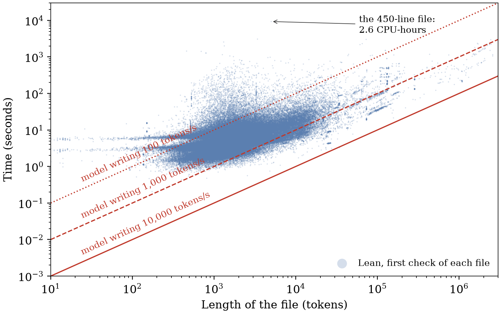

# AI 写 Lean 证明的速度，已经超过 Lean 检查它们的速度

AI 越来越会写数学证明了。随之而来的问题是：它写出来的东西，我们查得过来吗？常见的回答是交给形式化验证：让 AI 把证明写成 Lean 代码，由 Lean 自动逐步核对，核对通过就说明证明成立，而机器检查又快又便宜。

我们用 OpenAI 公开的 AI 生成数学库检验了这个回答，发现 AI 写 Lean 证明的速度，已经超过了 Lean 检查它们的速度。一个 450 行的文件，模型一分钟之内就能写完，Lean 用一个处理器核心检查它却花了 2.6 个小时。在库里的 162,170 个文件中，如果模型每秒输出 1,000 个 token（token 是模型输出文字的基本单位，在 Lean 源码里平均两三个字符），95% 的文件都是模型先写完、Lean 后查完。形式化验证本应是让我们信任 AI 所写数学的那个廉价步骤，对 AI 写的证明来说，它正在变成昂贵的那一步。

如果模型继续变快，这个差距还会扩大。模型的输出速度随着硬件和批量推理持续提高，Lean 检查一个文件基本只用到一个处理器核心，而 AI 写出的证明，又越来越多地把搜索和计算交给 Lean 去完成。

<!-- more -->

## 逐个文件对比

图 1 把这两种速度画在一起。三条红线表示模型分别以每秒 100、1,000 和 10,000 个 token 写出一个文件要多久。每秒 100 个大致相当于一路聊天式输出；一张 GPU 批量服务一个小模型就能超过每秒 10,000 个，我们在之前的项目里测过，一张 RTX 5090 上的 5 亿参数模型每秒输出 11,645 个 token。每个蓝点是库里的一个文件，以及 Lean 第一次检查它所用的处理器时间。蓝点落在某条红线上方，说明 Lean 检查这个文件，比模型以这个速度写出它还慢。



绝大多数蓝点落在中间那条线的上方：模型以每秒 1,000 个 token 写，在 95% 的文件上先写完；以每秒 10,000 个 token 写，在所有文件上都先写完；即使只有每秒 100 个 token，也有 8% 的文件是模型先写完。从整个库看，Lean 在一个性能核上检查一个中等文件，每秒大约处理 400 个 token。

## Lean 为什么落后：AI 把活交给了它

人写的严谨证明会把推理过程一步步写出来。AI 写的证明常常是一条简短的指令，让 Lean 自己去完成工作，这些工作分两种。

第一种是搜索。Lean 的策略（tactic）是“化简一下”“试试常用的算术事实”这样的命令，具体步骤由 Lean 自己去找。开头那个 450 行的文件，是整个库里最贵的文件，里面 `decide` 的调用次数为零，2.6 个小时都花在 Lean 处理它的策略和定义上。

第二种是计算。下面这行证明说的是，1,000 以内每个数的平方，除以 7 的余数都是 0、1、2 或 4：

```lean
theorem squares_mod_7 : ∀ n < 1000, n * n % 7 ∈ [0, 1, 2, 4] := by decide +kernel
```

模型写出这一行只要几十个 token。`decide +kernel` 让 Lean 把 1,000 个数逐个平方再取余，在我们的测试里，一个核心用了 1.3 秒。AI 很爱用这种写法：OpenAI 的库里有 1,354,379 处 `decide +kernel`，分布在 5,848 个文件中，而人写的主要 Lean 库 Mathlib 里只有 7 处。按每兆字节源码计算，AI 库的使用频率是 Mathlib 的 10,668 倍。每一处调用，都是交给 Lean 去跑的一段计算。

## 一个库的账单

检查这个库 163,096 个文件中的 162,170 个，一台 24 核的台式机处理器连续跑了 31.5 小时。另外 926 个文件先搁置了，它们属于几个特别耗内存的模块族，以及依赖这些模块族的文件，所以完整的账单还要更大。开销分布很集中：1% 的文件用掉了四分之一的处理器时间，使用 `decide +kernel` 的那 3.6% 的文件用掉了 18%。

## 把证明存下来，能省多少

Lean 第一次检查一个文件时，要运行其中所有的策略；检查通过后，它会把完整的证明存下来，之后再检查时，可以交给 Lean 那个小而可信的核心直接重放，跳过全部搜索。

普通证明这样复查很便宜，只需第一次检查时间的 0.5% 到 6.5%。我们从库里随机抽了 100 个文件，实测重放它们存下来的证明：对比每秒写 1,000 个 token 的模型，3% 的文件重放得更慢；对比每秒 10,000 个 token，这个比例是 13%。

计算留在证明里，所以计算式的文件每查一次都要重算一次：其中两个文件的复查，分别用了第一次检查时间的 80% 和 82%。

## 该怎么办

在 AI 写证明的流程里，Lean 的检查是信任的入口；训练 AI 证明器时，Lean 的判定又是模型学习的奖励信号。两处都要求检查跟得上写。

- 在准备生成算力的同时，给检查留出算力，按“每 CPU 秒能检查多少 token”做预算。
- 计算式证明要逐个文件估算开销，项目平均值会把它们掩盖掉。
- 说清一次检查覆盖了哪些文件：这个库的默认构建只编译其中五分之四的文件。

## 这些数字的范围

我们比较的是 Lean 的耗时，和模型写出最终文件所需的时间。AI 系统生成这个文件时还用掉了更多 token，花在推理过程和失败的尝试上，这部分成本在我们的数据之外。所有测量都来自同一台机器、同一个库的同一个版本，以及 Lean 4.34.1。

## 工具和报告

我们把这套检查流程整理成了开源工具 [ProofServe](https://github.com/yunwei37/proofserve)，目前是 [0.1.0 版](https://github.com/yunwei37/proofserve/releases/tag/v0.1.0)。它用 Lean 自己的可信核心并行复查一个已编译的 Lean 项目，生成一份回执，列出检查了哪些内容，还会报告默认构建漏掉了哪些文件。完整的测量见六页的[技术报告](../../papers/proofserve.pdf)，本文每个数字背后的数据都在代码仓库里。
