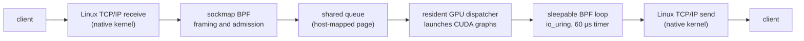

# Does moving a GPU server's request loop into the kernel save CPU?

Picture a GPU server answering many small requests: a tiny language model generating 64 tokens, or a short cuBLAS or cuFFT call. The GPU work per request is short, so the host side becomes visible. Each request crosses the network stack, wakes a server thread, gets copied into user memory, waits in a queue for the GPU, and goes back out through another send.

Linux now offers enough pieces to remove that server thread. A sockmap BPF program can parse requests on a TCP socket inside the kernel. On recent kernels such as Linux 7.3, a sleepable BPF program can submit and complete io_uring operations by itself. A persistent GPU kernel can launch captured CUDA graphs without the host. Put together, userspace only needs to start the service, and after that no user thread reads, schedules, or sends a request.

It sounds like it should save CPU and shorten tail latency, because it skips system calls, copies, and wakeups. We built this design as [bpf-gpu-server](https://github.com/yunwei37/bpf-gpu-server) and measured it carefully. On our testbed it did neither. This post explains the setup, the results, and the reason, which turns out to be useful well beyond this project. The four-page write-up is available as a [PDF](../../papers/bpf-gpu-server.pdf).

<!-- more -->

## What the system does

At startup, a normal userspace process creates the listening socket, captures the caller's CUDA graphs, maps a page of memory that both CPU and GPU can access, attaches the BPF programs, and launches a resident GPU dispatcher. Then it steps back. It stays alive to own the memory and to handle shutdown, but it does not touch individual requests.

A request arrives through the normal Linux TCP stack. A sockmap BPF program frames it, checks it, and publishes it into a queue in the shared page. The GPU dispatcher picks it up, launches the right graph, and publishes the output. A BPF program attached to io_uring notices the completion, submits a send, keeps replies in order, and reclaims finished connections. While work is in flight, that loop waits for the next completion event or a 60 µs timer.

The system runs two kinds of computation through the same transport: unchanged cuBLAS and cuFFT graphs, and LLM generation that replays upstream vLLM or Hugging Face graphs for Qwen2.5-0.5B and SmolLM2-135M. It needs no custom kernel module on Linux 7.3.

## How we made the comparison fair

The interesting question is narrow. A server built carelessly in Python would lose to almost anything, so beating it proves little. We compared against a C++ server that uses timed epoll and nonblocking reads and writes, and that drives the *same* GPU dispatcher, the same queue, and the same graphs. Only the placement of the network loop differs. We call it the native path.

For the LLM workload we also ran official vLLM with its optimized defaults. vLLM has its own API, scheduler, and memory manager, so it tells us how the whole design compares with a production server, while the native path isolates the transport.

CPU needs careful bookkeeping here, because moving code into the kernel changes where its cost is charged. We report the CPU charged to the service's threads (user plus system time, including io_uring workers) separately from whole-host totals, and we never add the two.

The server was an Intel Core Ultra 9 285K with 24 logical CPUs, an RTX 5090, and Linux 7.3-rc3, with load coming from a second machine. Each condition ran as five paired process blocks, and every output was checked by exact replay.

## Results: the network loop's placement made no difference

For LLM serving, Qwen2.5-0.5B at 192 requests per second for 60 seconds, the two transports delivered the same 11,645 tokens per second. Completion P99 was 3,304 ms on the kernel path and 3,314 ms on the native path, a difference whose confidence interval crosses zero. CPU charged to the service was 0.835 ms per request on the kernel path and 0.812 ms on the native path.

The small-request experiment is where host overhead should matter most. We ran cuBLAS GEMM and cuFFT requests with 280-byte inputs and 256-byte outputs over 128 persistent connections, swept work size, request rate up to saturation, and the number of CPUs the service could use, and then confirmed three selected points with fresh seeds. That is 3.12 million requests in total, none of which failed. Before running it we wrote down what would count as an advantage: at least 10% less CPU with the tail no more than 5% worse, or a tail at least 10% better with CPU no more than 5% higher, in both cases losing less than 2% throughput. None of the three points qualified. The largest CPU reduction anywhere in the sweep was about 5.8%. With the service limited to one logical CPU, the kernel path's P99 was 2.6 times worse.

The CPU split explains why:

| Per request, FFT at 1,000 requests/s | User time | System time | Total |
|---|---:|---:|---:|
| Native epoll | 11.3 µs | 26.2 µs | 37.56 µs |
| Kernel-owned | 2.8 µs | 35.2 µs | 37.96 µs |

Removing the userspace loop did cut user time by three quarters. The same work then reappeared as system time, and the total differed by only 1.1% for FFT and 1.9% for GEMM. Whole-host CPU told the same story.

## Where the cost goes

Three effects explain the table.

The expensive part of each request is the TCP/IP stack itself: interrupts and softirq processing on receive, socket buffers, the TCP state machine, acknowledgments, and transmission. Sockmap runs *after* TCP has reassembled the stream, so both designs pay for the whole stack. What the kernel path removes is the system call boundary and one copy into user memory, which is a small slice of the roughly 38 µs each request costs on this machine.

The server loop also moves instead of disappearing. Something has to notice that the GPU has finished and submit the reply. A GPU cannot cheaply trigger kernel work, so the BPF loop runs in a service thread that wakes on completion events or a timer, reads queue state through BPF maps, and submits io_uring operations. That thread's time is charged as system time. An epoll server also gets an advantage from batching: one `epoll_wait` returns many ready sockets, while the BPF path pays for program invocations, map operations, and io_uring entries on every request.

A profile of the LLM workload shows the difference directly. Before we fixed a polling bug, the kernel path's service thread was on the CPU about four times as often as the native thread. 71% of its kernel samples were loop coordination and BPF map operations, work the epoll design does not have, while the native thread spent 85% of its kernel samples on networking and softirq, the work both designs must do. Fixing the busy-polling branch cut the kernel path's CPU from 1.70 to 0.63 ms per request for LLM serving, but in the small-request experiment the remaining coordination still cancelled the user-time savings.

When CPUs are scarce, timing also gets worse. With one logical CPU, the BPF loop competes with network softirqs on the same core, and timer-driven wakeups add delay that readiness-driven epoll avoids. That matches the 2.6 times worse P99.

## What actually moved the numbers

The changes that made a large difference applied to both transports, and several are worth knowing for anyone who puts a TCP front end on a GPU.

The biggest LLM tail improvement came from capacity. With 16 GPU slots, 192 requests per second exceeded what the executor could deliver, so the queue grew for the entire run: time to first token rose from about 235 ms in the first 10 seconds to about 3,003 ms in the last 10 seconds, while generation itself stayed near 86 ms. Raising capacity to 32 slots, which we measured on the native transport, cut completion P99 from 3,337 ms to 217 ms, below official vLLM's 406 ms at the same throughput. It cost slightly more time per token, more GPU memory, and about 0.34 J more device energy per request than vLLM.

Small streamed replies also collided with Nagle's algorithm and delayed ACKs. In one captured case, a 4-byte write left 36 more bytes waiting about 41 ms for an acknowledgment. Every stream paid a 40 ms gap until the listener set `TCP_NODELAY`, which brought the token-gap P99 from 40.5 ms down to 2.3 ms and raised throughput from 8,842 to 11,260 tokens per second.

Connection lifetime caused the next problem. Under sustained load, the kernel path kept finished connections until an unrelated global queue drained. Almost 3,000 sockets sat in `CLOSE_WAIT`, the socket map filled up, and new requests failed. Reclaiming each connection when its own work finished removed all 4,157 timeouts.

Packing new prefills together with ongoing decode steps in the same GPU batch, the same idea as Sarathi-Serve, reduced mean time per token by about 14% on both paths.

The resident GPU executor also used ten to sixteen times less process CPU per request than the vLLM server. Most of that gap comes from moving step scheduling onto the GPU and from returning token IDs instead of JSON text. Both transports share it, so kernel networking does not explain it.

## When moving work into the kernel does pay off

The eBPF projects with large speedups intercept work before the expensive layers. BMC and Electrode act at XDP, before the network stack, and XRP resubmits storage requests from inside the NVMe driver. GPU networking systems that take the CPU off the data path bypass the host stack altogether, as GPUnet did with RDMA and as NVIDIA DOCA GPUNetIO does by letting GPU kernels drive NIC queues. bpf-gpu-server deliberately kept ordinary Linux TCP for compatibility, and that choice means paying the stack's cost on every request, whichever thread or program drives the loop.

If you want the CPU savings this design promised, the next experiment is to change where packets are processed, for example AF_XDP into GPU-visible memory or a direct NIC-to-GPU path, and accept the protocol and hardware constraints that come with it.

## Limits

All of this comes from one host with 24 logical CPUs and one RTX 5090, a single remote client, small models, fixed-shape requests, a binary protocol, and no TLS. The CPU charged to the service does not include softirq work charged to other contexts, and whole-host counters include unrelated activity and our own measurement overhead. A machine whose cores are scarce for other reasons, a NIC tuned specifically for this traffic, or a design that bypasses the host stack could lead to a different conclusion.

## Takeaways

Before moving code across the user/kernel boundary, measure the cost floor first: if most per-request CPU sits in the TCP stack, relocating the loop cannot remove it. Compare against a baseline that shares everything except the variable you are testing. Count CPU in every scope, because lower user time can be paid back in system time. In small-model serving, check capacity and small-send TCP behavior before anything else, since those changed tail latency by an order of magnitude here while the transport did not.

bpf-gpu-server remains available as an open research prototype for kernel-owned TCP around reusable CUDA graphs on stock Linux. The [repository](https://github.com/yunwei37/bpf-gpu-server) contains the source, raw data, and every finding, including the failed attempts. The four-page paper is [here](../../papers/bpf-gpu-server.pdf).
